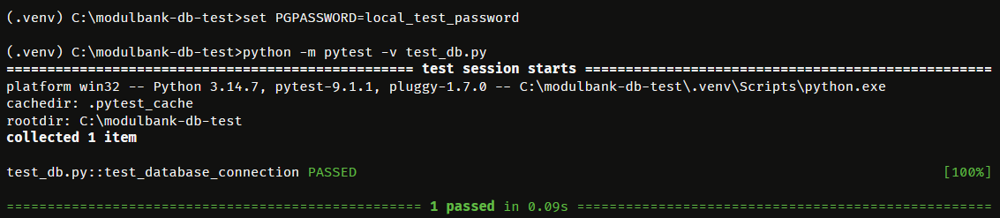
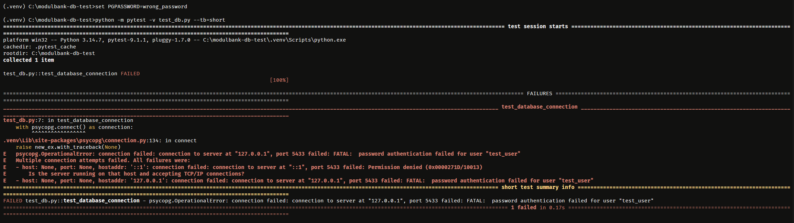

# Проверка подключения к PostgreSQL

Тестовое задание для стажировки в Модульбанке.

PostgreSQL запускается в Docker, Python-тест — локально.
Тест должен подключиться к БД, выполнить `SELECT NOW()`
и проверить, что получено значение даты и времени.

## Требования

- Docker с Docker Compose
- Python 3
- Bash / WSL для команд ниже

## Подготовка окружения

### Windows
```cmd
py -m venv .venv
.venv\Scripts\activate.bat
python -m pip install pytest "psycopg[binary]"
```

### Linux

```bash
python3 -m venv .venv
source .venv/bin/activate
python -m pip install pytest "psycopg[binary]"
```

## Запуск PostgreSQL

```bash
docker compose up -d --wait
```

Параметры локальной тестовой БД:

| Параметр | Значение |
|----------|----------|
| Хост | localhost |
| Порт | 5433 |
| База | test_db |
| Пользователь | test_user |
| Пароль | local_test_password |


## Настройка подключения

Тест `test_db.py` должен читать параметры из переменных окружения:

### Windows
```cmd
set PGHOST=localhost
set PGPORT=5433
set PGDATABASE=test_db
set PGUSER=test_user
set PGPASSWORD=local_test_password
set PGCONNECT_TIMEOUT=5
```

### Linux
```bash
export PGHOST=localhost
export PGPORT=5433
export PGDATABASE=test_db
export PGUSER=test_user
export PGPASSWORD=local_test_password
export PGCONNECT_TIMEOUT=5
```

## Результаты проверки

Успешное подключение:



Ожидаемое падение с неверным паролем:




## Остановка

```bash
docker compose down -v
```

Команда удаляет контейнер и его анонимные тома с тестовыми данными.
